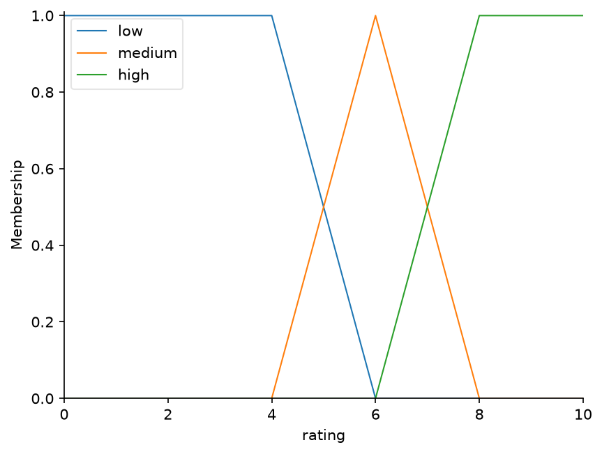
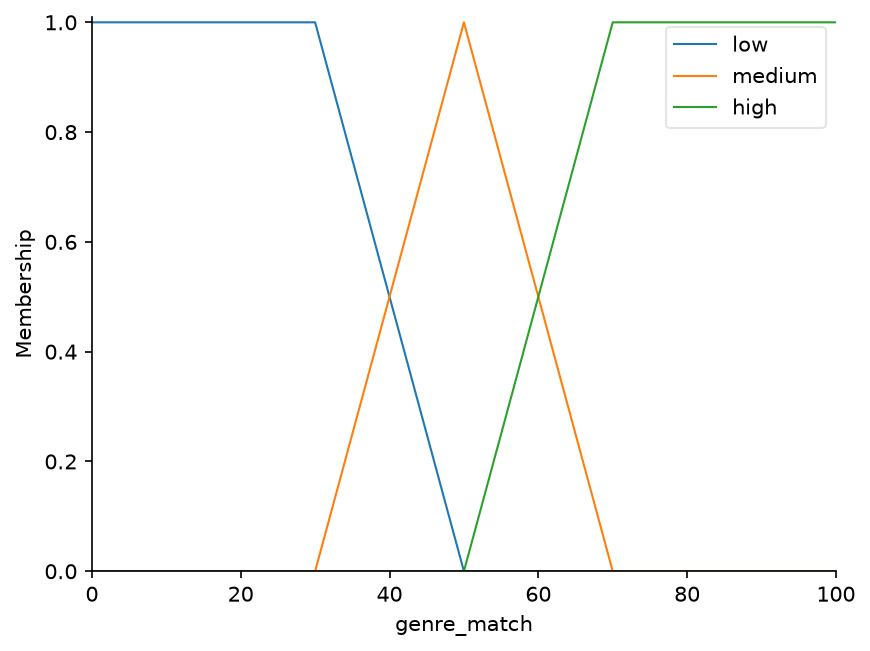
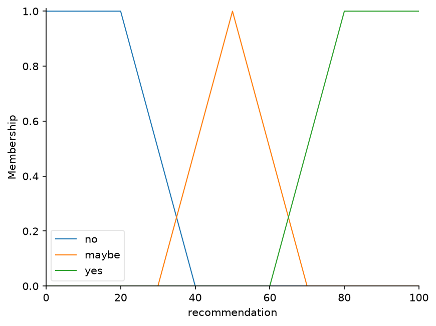
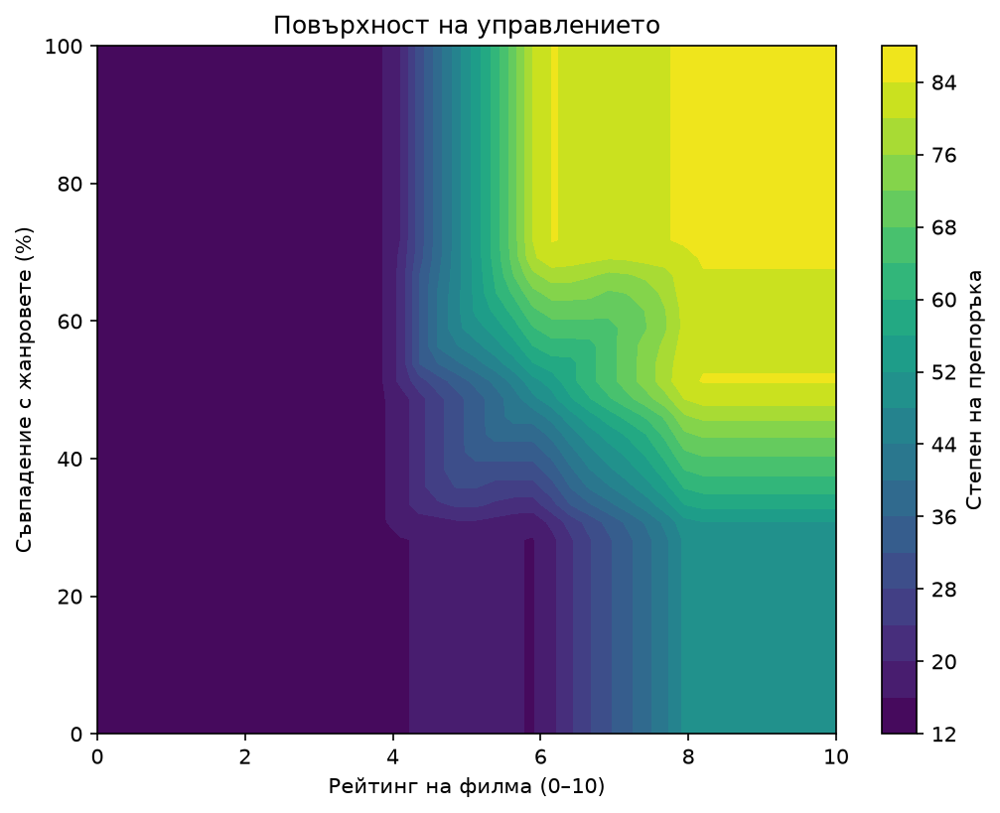

# Система за препоръка на филми с размита логика

Курсов проект по **Интелигентни системи** – размито управление, реализиран на Python с библиотеката `scikit-fuzzy`.

## 1. Мотивация

Препоръките за филми често се основават на твърди правила („ако рейтингът е над 7, препоръчай“). В реалността предпочитанията са неясни: филмът е „доста добър“, „горе-долу в любимите ми жанрове“ или „почти сигурно няма да ми хареса“. Размитата логика позволява да се формализират тези неясни понятия чрез степени на принадлежност и да се получи плавна, обяснима оценка вместо отговор „да“ или „не“.

## 2. Описание на задачата

Системата получава два входа за даден филм и връща една оценка:

| Променлива | Тип | Диапазон | Описание |
|---|---|---|---|
| Рейтинг (`rating`) | вход | 0 – 10 | Оценка на филма от зрители или критици |
| Съвпадение с жанровете (`genre_match`) | вход | 0 – 100 % | Колко добре жанровете на филма съвпадат с предпочитанията на потребителя |
| Препоръка (`recommendation`) | изход | 0 – 100 | Степен, с която филмът се препоръчва |

Интерпретация на изхода: под 40 – не се препоръчва, между 40 и 60 – „може би“, над 60 – препоръчва се.

## 3. Имплементация

### 3.1 Функции на принадлежност

Използвани са трапецовидни (`trapmf`) и триъгълни (`trimf`) функции.

**Рейтинг:** ниско (`low`), средно (`medium`), високо (`high`)



**Съвпадение с жанровете:** ниско (`low`), средно (`medium`), високо (`high`)



**Препоръка:** не (`no`), може би (`maybe`), да (`yes`)



### 3.2 База от правила

| № | Рейтинг | Съвпадение с жанровете | Препоръка |
|---|---|---|---|
| 1 | високо | високо | да |
| 2 | високо | средно | да |
| 3 | средно | високо | да |
| 4 | средно | средно | може би |
| 5 | високо | ниско | може би |
| 6 | средно | ниско | не |
| 7 | ниско | – | не |

Правилата отразяват здрав разум: нисък рейтинг почти винаги означава „не“, а високият рейтинг компенсира само частично слабото съвпадение с жанровете.

### 3.3 Извод и дефаззификация

Използва се Mamdani модел. Операцията „и“ (AND) е минимум, а изходът се дефаззифицира с метода **центроид** (`centroid`), който връща една конкретна стойност от 0 до 100.

### 3.4 Повърхност на управлението

Графиката показва как изходът се променя при различни комбинации от рейтинг и съвпадение с жанровете.



### 3.5 Примерни резултати

Резултатите са получени с `python demo.py`:

| Филм | Рейтинг | Съвпадение (%) | Степен на препоръка |
|---|---|---|---|
| Inception |  8.8 | 90 | 84.4 |
| Classic Drama | 8.0 | 70 | 84.4 |
| Obscure Thriller  | 7.5 | 40 | 57.0 |
| Romantic Comedy X | 5.2 | 85 | 56.0 |
| Bad Action Film | 3.1 | 60 | 15.6 |

## 4. Инсталация и стартиране

Изисква се **Python 3.12** (`scikit-fuzzy` не е напълно съвместима с по-новите версии).

```bash
git clone https://github.com/martinchoto72/skfuzzy-movie-recommendation-system.git
cd skfuzzy-movie-recommendation-system
python -m venv venv
source venv/bin/activate          # Windows: venv\Scripts\activate
pip install -r requirements.txt
```

Стартиране на примера:
```bash
python demo.py
```

Генериране на графиките:
```bash
python plots.py
```

Изпълнение на тестовете:
```bash
python -m pytest -v
```

## 5. Ограничения и възможно развитие

- Съвпадението с жанровете се въвежда ръчно. Възможно разширение е автоматично изчисляване от история на гледанията.
- Системата използва два входа. Трети вход (например настроение, продължителност или любими актьори) би направил оценката по-точна.
- Функциите на принадлежност и правилата са определени експертно. Възможно е настройка по данни от реални потребители.

## Автор

Мартин Сталев гр 78. ИСН

## Лиценз

Проектът е разпространен под лиценз GPL-3.0. Вижте файла `LICENSE`.
